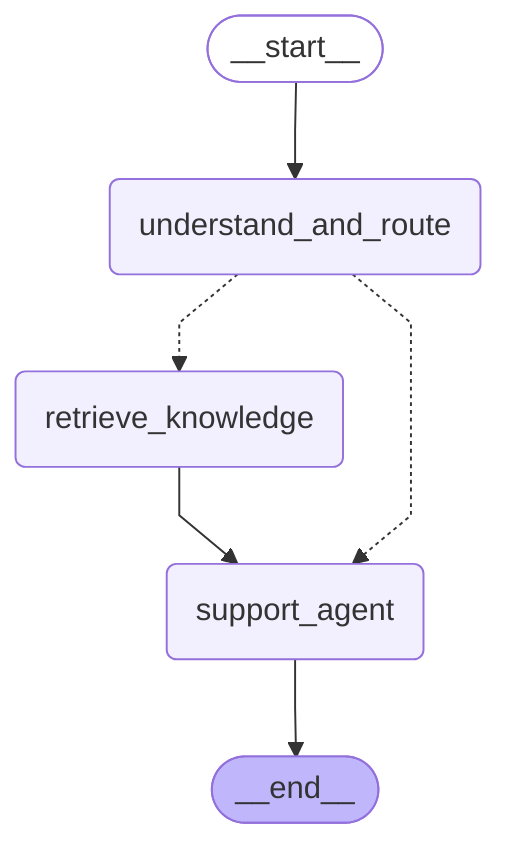

# 单 Agent 售后总图

订单查询、退款办理、追问和最终回复统一由 `support_agent` 完成。
意图识别只决定是否需要先检索文档，不再切换订单 / 退款 Agent。
当前未接入 `/conversation`；可通过 `tests/test.agent.py` 测试总图。

以下连线由 `build_support_graph().get_graph().draw_mermaid()` 生成：



## 三个节点

| 节点 | 职责 | 当前实现 |
| --- | --- | --- |
| understand_and_route | 结合消息历史识别需求，整理知识问题；由代码决定出口 | 已实现 |
| retrieve_knowledge | 按问题召回文档，型号补入查询文本，返回带来源的片段 | 已接 Milvus 向量召回，返回 `ready` / `empty` / `unavailable` |
| support_agent | 同时使用订单、退款的 7 个工具；追问或答复；有文档时根据本轮证据回答 | 已接入统一 Agent |

普通订单 / 退款需求和不明确的需求直接交给 `support_agent`，由它完成追问。
商品使用和通用政策问题经过检索节点后，也由同一个 Agent 回答。
知识检索失败、无匹配或资料不足时，提示词要求如实说明，不生成无依据的操作步骤。
不再需要独立的 `order_agent`、`refund_agent`、`clarify` 或 `answer_knowledge` 节点。

## State：需要保存的对话数据

| 字段 | 内容 |
| --- | --- |
| messages | 用户、AI、工具调用与工具结果；使用消息合并规则 |
| current_intent | 本轮意图，用于区分业务办理与知识咨询 |
| next_node | 本轮出口：`support_agent`、`retrieve_knowledge` 或 `end` |
| knowledge | 本轮完整检索问题和商品型号 |
| retrieved_documents | 本轮文档片段及来源，整体替换 |
| retrieval_status | `not_requested` 未请求；`unavailable` 尚不可用；`empty` 无匹配；`ready` 有结果 |

移除了此前用于两个 Agent 交接的 `order`、`refund` 子状态。
订单确认、原因、取消等对话信息由统一 Agent 从消息历史理解；真实业务状态仍以数据库和工具结果为准。
提示词约束不是业务校验的替代：用户归属、退款资格和重复申请仍由服务层检查。

每轮意图识别都会清空旧证据并重建检索输入，避免换商品或回到退款时复用旧资料。
`initial_state()` 可用于查看新会话默认值；实际调用只传新增消息即可，不要每轮重置整份 State。

## Context：本次执行的服务端资源

`SupportContext` 包含 `user_id`、`conversation_id`、`db`。
节点接收 State，通过 `runtime.context` 读取这些资源；Context 不放进 State，也不作为对话记忆保存。
调用方负责认证、会话归属校验，并保证数据库会话在整个图调用期间打开。
恢复下一轮时重新传入 Context，不复用已关闭的数据库会话。

```python
from supportflow.agents.graph.builder import build_support_graph
from supportflow.agents.graph.context import SupportContext

graph = build_support_graph(checkpointer=saver)
config = {"configurable": {"thread_id": conversation_id}}

async with SessionLocal() as db:
    context = SupportContext(
        user_id=user_id,
        conversation_id=conversation_id,
        db=db,
    )
    result = await graph.ainvoke(
        {"messages": [("user", "我想退买的充电宝")]},
        config,
        context=context,
    )
```

提交退款时，`conversation_id` 必须是业务库中属于当前用户的真实会话 ID。
`END` 只结束本轮；下一轮用同一 `thread_id` 恢复历史。
总图保存 checkpoint，内部 Agent 设置 `checkpointer=False`，避免两层重复管理历史。
此设置也会关闭内部 Agent 的逐步持久化（参见 [LangGraph Checkpointer 文档](https://reference.langchain.com/python/langgraph/types/Checkpointer)）；当前没有实现工具执行到一半的中断恢复。
Agent 节点回传全部新增消息，包括成对的工具调用和结果，不只返回最后一句话。
本轮检索资料临时加入系统提示，不追加为长期历史消息；以后每轮咨询重新检索。

## 当前边界

- 知识检索已接入稠密向量召回，默认 Top-5、最低 COSINE 分数 0.5（尚待校准）。尚无 BM25、RRF 或重排；型号只补入检索问题，不构成严格型号过滤。详见 [向量召回](vector-retrieval.md)。
- 意图识别仍需一次模型调用；售后 Agent 内部再进行模型与工具循环。
- 手动脚本按总图节点输出更新，`support_agent` 完成后一起显示本次工具调用与回复。
- 离线测试使用脚本化模型和模拟业务服务，验证接线、身份传递、多轮消息与证据隔离，不代表真实模型一定遵守每条业务规则。
