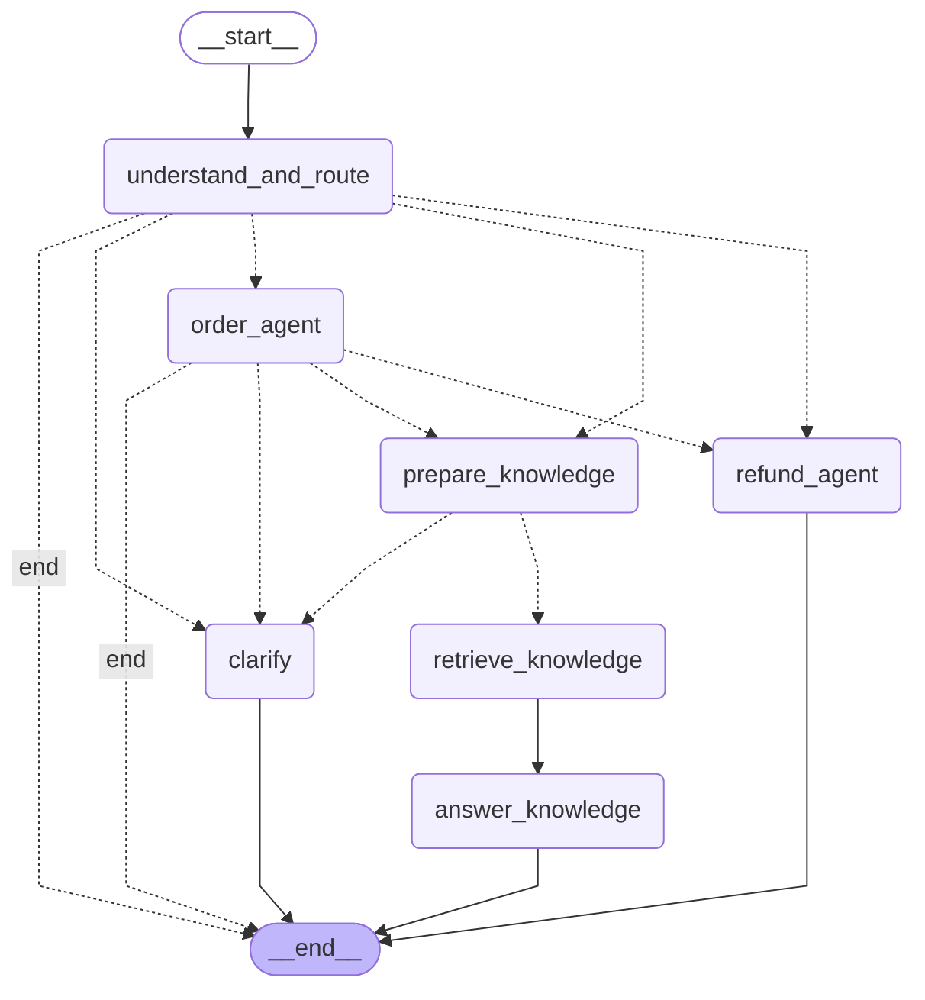

# 售后总图骨架

当前只定义节点接口和连线，业务节点均显式抛出 `NotImplementedError`。可以编译和画图，尚不能执行业务对话；未接入 HTTP 路由。

下图由 `build_support_graph().get_graph().draw_mermaid()` 生成，虚线表示条件分支。



| 节点 | 职责 |
| --- | --- |
| understand_and_route | 理解输入、更新意图和办理进度、选择下一节点 |
| order_agent | 包装订单 Agent，定位订单并决定是否交接 |
| refund_agent | 包装退款 Agent，查询、追问或提交后结束本轮 |
| prepare_knowledge | 准备问题、检查必要信息、清空旧证据 |
| retrieve_knowledge | 调用检索服务，返回本轮文档片段 |
| answer_knowledge | 普通节点调用模型，依据文档回答并附来源 |
| clarify | 澄清意图或追问缺失信息 |

## 节点协议

```python
async def node(
    state: SupportState, runtime: Runtime[SupportContext],
) -> SupportStateUpdate:
    user_id = runtime.context.user_id
    # 只返回本次需要更新的字段
    return {"refund": {**state["refund"], "reason": "用户提供的原因"}}
```

- 条件出口使用 `next_node`；节点必须明确写入本轮出口，不能沿用上一轮结果。
- `end` 映射到 LangGraph 的 `END`，表示本轮结束，不是清空对话。
- 追问后结束本轮；下一轮从 `understand_and_route` 重新进入并读取保存的进度。
- 总图使用同一会话的 checkpoint；后续接口负责会话归属校验，且 `thread_id` 与 Context 的会话 ID 一致。
- 图内没有知识 Agent 或 Review Agent，检索和依据文档回答是普通节点。
- 后续实现顺序：理解与路由 → 订单包装 → 退款包装 → 知识节点。
